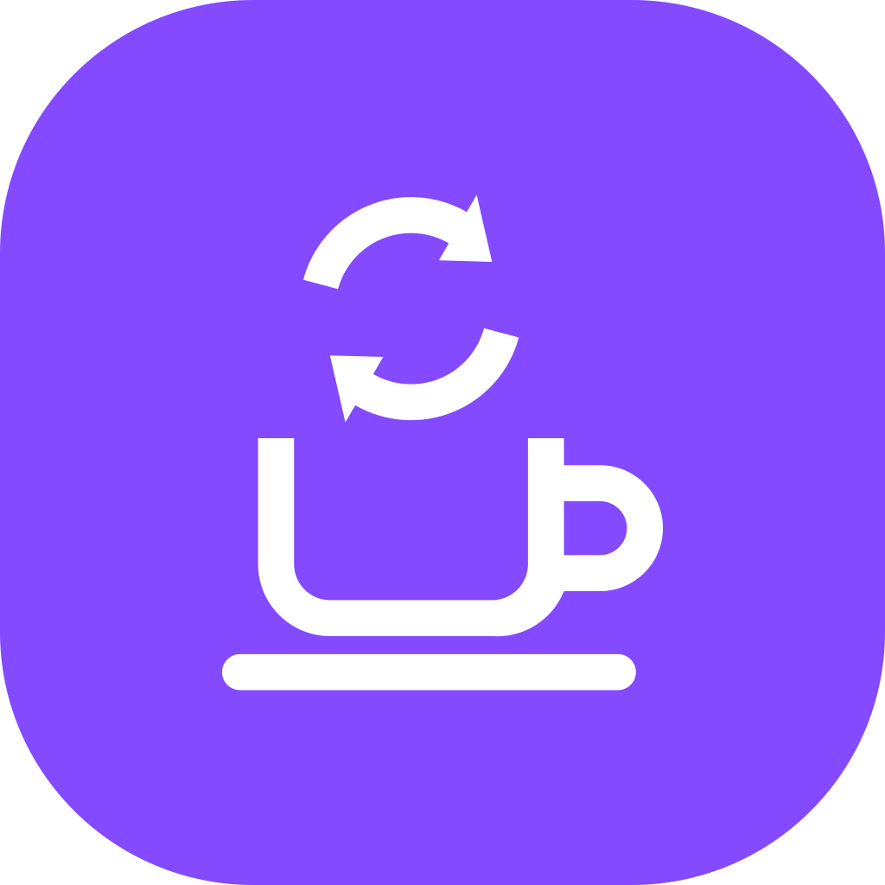

<!-- Copyright (c) 2026, Avunu LLC and contributors
For license information, please see license.txt-->

<!-- frappe-nix:begin header -->

<div align="center">



# Espresso Sync

Two-way sync between Frappe documents and external REST APIs

[](https://github.com/Avunu/espresso_sync/actions/workflows/ci.yml)
[](https://github.com/Avunu/espresso_sync/releases)
[](license.txt)
[](https://github.com/frappe/frappe/tree/version-16)
[](https://docs.avunu.net/espresso-sync/)

</div>

<!-- frappe-nix:end header -->

## Overview

Espresso Sync moves documents between a Frappe site and external REST APIs, in either direction. An **Espresso Sync Connection** holds an API's address and credentials; each of its **shots** maps one DocType to one endpoint, imports from it, exports to it, or both. Imported objects are matched to documents through the **Espresso Sync ID** table the app adds to each synced DocType, and every request is recorded in an **Espresso Sync Pull Log** with its credentials redacted.

Field maps are JSON objects whose values are [JSONata](https://docs.jsonata.org/) expressions, with a few Frappe tags (`{link:…}`, `{id:…}`, `{doc:…}`, `{get_value:…}`) for lookups in the site. The syntax is described in [docs/object-mapping.md](docs/object-mapping.md).

Syncs run on demand, with **Sync Now** on the Connection form; scheduled syncs return in a later release. Only a System Manager can configure a Connection or run it.

This map format is being replaced by a schema-aware transform editor driven by the APIs' OpenAPI descriptions; until then the app is not listed in the Frappe marketplace.

<!-- frappe-nix:begin compatibility -->

## Compatibility

| Frappe | Branch       |
| ------ | ------------ |
| v16    | `version-16` |

<!-- frappe-nix:end compatibility -->

<!-- frappe-nix:begin installation -->

## Installation

```bash
bench get-app https://github.com/Avunu/espresso_sync --branch version-16
bench --site <site> install-app espresso_sync
```

<!-- frappe-nix:end installation -->

<!-- frappe-nix:begin support -->

## Support

- Documentation: [docs.avunu.net/espresso-sync/](https://docs.avunu.net/espresso-sync/)
- Bug reports and questions: [GitHub issues](https://github.com/Avunu/espresso_sync/issues)
- E-mail: <mail@avu.nu>

<!-- frappe-nix:end support -->

<!-- frappe-nix:begin development -->

## Development

```bash
nix develop        # or: direnv allow
prek install       # the git hooks CI runs
frappe-test        # the tests, the way CI runs them
```

The managed files, checks and release flow are described in the [app standards documentation](https://docs.avunu.net/frappe-nix/docs/app-standards/).

<!-- frappe-nix:end development -->

<!-- frappe-nix:begin license -->

## License

MIT, Copyright (c) 2023–present Avunu LLC → [license.txt](license.txt)

<!-- frappe-nix:end license -->
